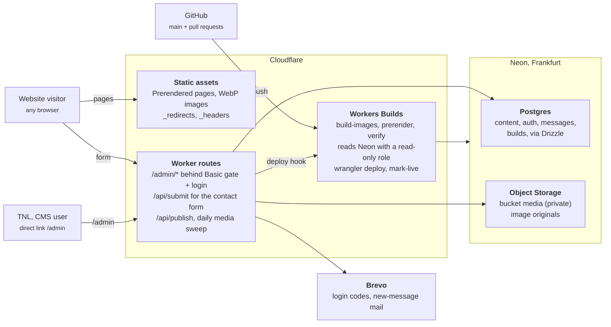

# Architecture

Visitors only ever load static files from Cloudflare. Neon is read by the build, and written only by the CMS and the contact form.

A save in the CMS writes to Postgres and Object Storage and leaves the live site unchanged. **Publiceren** calls the deploy hook; Workers Builds reads Neon, prerenders every page, copies the images and deploys new static assets. The only moving parts at request time are the Worker routes behind `/admin` and `/api`.
