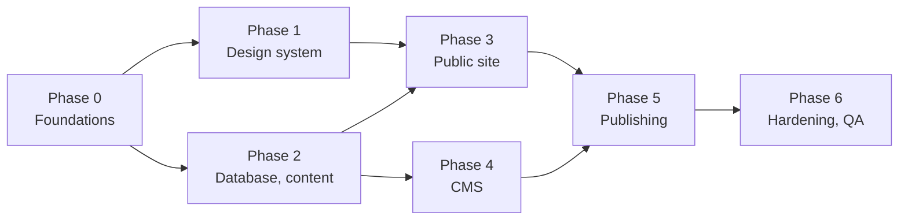

# Phases and tasks

Seven phases. After phase 0, phases 1 and 2 can run side by side, and so can phases 3 and 4. Each task is done only when its criterion holds, checked by someone other than the author.

The public site (phase 3) needs both the components and the content; the CMS (phase 4) needs the content and uses the components for its preview. Publishing (phase 5) needs both.

## Phase 0: Foundations

- [ ] Create the GitHub repo and the SvelteKit + TypeScript app with `@sveltejs/adapter-cloudflare`. Done when `npm run dev`, `npm run check` and `npm run build` pass on a clean clone.
- [ ] Create the Neon project (Free plan) in `aws-eu-central-1` with branches `main` and `dev`, the roles `tnl_app`, `tnl_build` and `tnl_backup`, autoscaling capped at 0.25 CU and usage e-mails on. Done when all three roles connect, and `tnl_build` and `tnl_backup` are both refused an `INSERT`.
- [ ] Create the `media` bucket (private) and two storage credentials (read/write, read-only). Done when a script uploads, reads and deletes a test file with the first, and the second is refused a write.
- [ ] Create the Worker, connect Workers Builds to the repo, set all variables and secrets. Done when a push to `main` deploys a hello page to `*.workers.dev` and a pull request gets a preview URL.
- [ ] Add GitHub checks for `check`, `lint` and unit tests on every pull request. Done when a failing check blocks the merge.
- [ ] Create the R2 buckets `tnl-backups` (with a 30-day lifecycle rule) and `tnl-media-mirror`, plus the workflows `db-backup.yml` and `media-mirror.yml`. Done when a manual run of each puts a dump and a copy of the test file in R2.
- [ ] Start Brevo domain authentication for `tnlgroup.be` and send TNL the DKIM and verification records to add at GoDaddy. Done when Brevo shows the domain as authenticated. This waits on TNL; nothing else in phase 0 does.

## Phase 1: Design system in Svelte

- [ ] Copy `tokens.css`, `tnl.css` and the fonts into `src/lib/styles`, and load them in the root layout. Done when a page renders in Geist with the paper background.
- [ ] Port the 18 components to Svelte, with props for everything the CMS will fill. Done when a dev-only route `/dev/components` renders each one matching `styleguide.html` at 1440 and 390 px.
- [ ] Replace `tnl.js` with Svelte actions (tabs, before/after, mobile menu). Done when keyboard use works as in the style guide: arrow keys on tabs, arrow keys on the slider, Escape closes the menu.
- [ ] Port the logo SVGs and the Lucide icons as components. Done when no icon is loaded through ``.

## Phase 2: Database and content

- [ ] Write the Drizzle schema for all tables in [Database schema](03-database.md), and generate the first migration. Done when the migration applies cleanly to an empty `dev` branch and is committed.
- [ ] Add the Better Auth tables with its CLI. Done when they are part of the same migration history.
- [ ] Write `scripts/seed-content.ts` with TNL's real content: the three services and sub-services, over-ons text, contact details, the six client photos, the FAQ answers from the design system, and the three stats. Done when running it twice leaves the same rows, with no duplicates.
- [ ] Write `content.ts` with typed read functions and the `seed.json` fallback. Done when `npm run build` succeeds with and without `DATABASE_URL_BUILD`.

## Phase 3: Public site

- [ ] Build every route in [Public site](06-public-site.md) from Neon content. Done when the build output has a static HTML file for every route, and the Worker is not invoked for them.
- [ ] `build-images.ts`: WebP variants and `srcset`. Done when no image on the site is larger than 2400 px and every `` has width, height and alt.
- [ ] SEO: meta, canonical, JSON-LD, sitemap, robots, `_redirects`. Done when `verify-build` asserts each page's title and description lengths and the JSON-LD counts, and every redirect answers 301.
- [ ] `/api/submit` with honeypot, Turnstile, rate limit, validation, mail-first notification and the no-JS fallback. Done when a form sent with JavaScript off lands on `/bedankt` and the message appears in `submissions`; the sixth submission from one IP within 10 minutes is refused; and with `DATABASE_URL` pointing at a stopped branch, the notification still arrives.

## Phase 4: CMS

- [ ] Basic gate, then Better Auth e-mail + password + e-mail OTP; sign-up off; `seed-account` script. Done when an anonymous request to `/admin` gets a bare 401, a wrong code is refused, and after the lockout threshold the account locks.
- [ ] Admin layout, Overzicht dashboard, Account. Done when the dashboard counts match the database.
- [ ] Editors for Pagina's, Diensten, Projecten, Reviews, FAQ, Cijfers, Blog, with preview. Done when every field of every table can be edited, and the preview matches the built page.
- [ ] Media library, upload flow and deletion rules. Done when replacing a photo deletes the old object from the bucket, a file still in use cannot be deleted, and the sweep removes a file left unused for 24 hours.
- [ ] Berichten, Instellingen, SEO & redirects. Done when changing the phone number in Instellingen changes it on every page after publishing.

## Phase 5: Publish pipeline

- [ ] `/api/publish`, the `builds` table, `build-info.json`, `mark-live`, and the publish banner. Done when the full cycle (edit, save, publish, live) is shown correctly, a build forced to fail shows *Mislukt*, and a double click starts one build.

## Phase 6: Hardening and QA

- [ ] `_headers`, `kit.csp` in `hash` mode, and the 12-month retention cron with CSV export. Done when securityheaders.com grades the preview A or better, and the browser console shows no CSP violations on any page or CMS screen, the Turnstile widget included.
- [ ] Rehearse a restore: load last night's dump from R2 into a scratch branch, and restore one photo from the mirror. Done when the restored branch builds the same site, and the steps are written in `HANDOVER.md`.
- [ ] Run the checks in [Testing and handover](11-testing-and-handover.md). Done when all pass on the production `*.workers.dev` URL.
- [ ] Write `README.md` and `HANDOVER.md` (how to publish, reset the password, restore a backup). Done when someone who did not build it can do all three from the documents alone.
